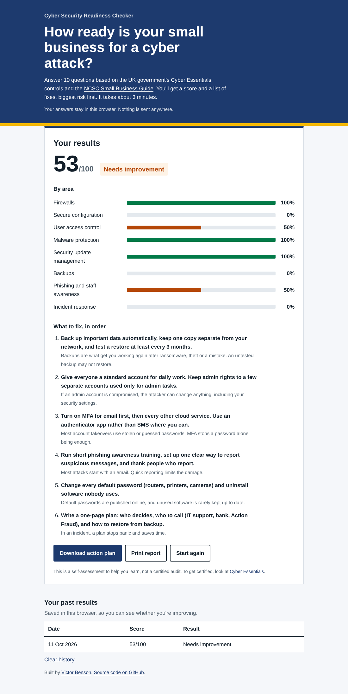
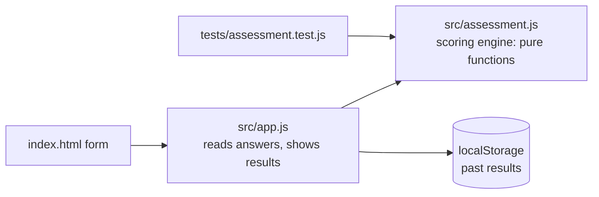

# Cyber Security Readiness Checker

[](https://github.com/macroer16/cyber-security-readiness-checker/actions/workflows/test.yml)

A 10-question self-assessment that tells a small business how ready it is for a cyber attack, and what to fix first. It's based on the UK's Cyber Essentials controls and the NCSC Small Business Guide.

**[Try it live](https://macroer16.github.io/cyber-security-readiness-checker/)**



## The problem

Most small businesses don't have an IT security team. Guidance like Cyber Essentials exists, but it's long, and owners don't know which gaps matter most. This tool turns it into 10 plain-English questions and a short, ranked to-do list.

## What it does

- **10 questions across 8 areas:** the five Cyber Essentials controls (firewalls, secure configuration, user access control, malware protection, security updates) plus backups, phishing awareness and incident response from the NCSC Small Business Guide.
- **Realistic answers:** Yes, Partly, No or Not sure. "Not sure" scores the same as "No", because you can't rely on a control you don't know is there.
- **Weighted scoring:** gaps that cause the most damage, such as no MFA, no backups or slow patching, count three times as much as lower-impact ones.
- **Ranked action plan:** fixes are ordered by how many points each gap costs, each with a one-line reason.
- **Results by area:** a bar for each area shows where the business is weakest.
- **Download and print:** download the action plan as a text file, or print a clean report (print to PDF works too).
- **Progress over time:** past scores are saved in the browser so a business can see whether it's improving.
- **Private by design:** everything runs in the browser. No answers are sent or stored on a server.

## How the score works

Each question has a weight from 1 to 3 (total 20 points). An answer scores 100% (Yes), 50% (Partly) or 0% (No / Not sure) of its weight.

```
score = round(points earned / 20 × 100)
```

| Score | Result |
|---|---|
| 85–100 | Strong foundation |
| 60–84 | Good start, with gaps to fix |
| 35–59 | Needs improvement |
| 0–34 | High risk |

Gaps are sorted by points lost, then by weight, so a half-done high-impact control ranks above a missing low-impact one.

## How it's built



- **`src/assessment.js`**: the questions, weights and scoring. Pure JavaScript with no browser code, so it can be tested on its own.
- **`src/app.js`**: builds the form, validates it, shows the report, and handles download, print and history.
- **No frameworks or build step:** plain HTML, CSS and JavaScript modules, hosted on GitHub Pages.

## Run it locally

```bash
git clone https://github.com/macroer16/cyber-security-readiness-checker.git
cd cyber-security-readiness-checker
python3 -m http.server 8000
# open http://localhost:8000
```

A local server is needed because the page uses JavaScript modules.

## Tests

```bash
npm test
```

There are 13 tests (Node's built-in test runner) covering the scoring, weights, ranking order, score bands, the per-area breakdown, the action plan text and invalid answers. GitHub Actions runs them on every push.

## Limitations

- It's a self-assessment for learning, not a certified audit. It can't check whether answers are true.
- 10 questions keeps it quick but can't cover everything in Cyber Essentials.
- History is stored only in the browser it was saved in.

## What I learned

_TODO (Victor writes this)_

## Next steps

- [ ] Explain each control in more detail with links to the matching NCSC guidance
- [ ] Export the report as a formatted PDF
- [ ] Compare two saved results side by side

## Sources

- [NCSC: Cyber Essentials overview](https://www.ncsc.gov.uk/cyberessentials/overview)
- [NCSC: Small Business Guide](https://www.ncsc.gov.uk/collection/small-business-guide)

Built by [Victor Benson](https://macroer16.github.io/victor-cloud-portfolio/).
